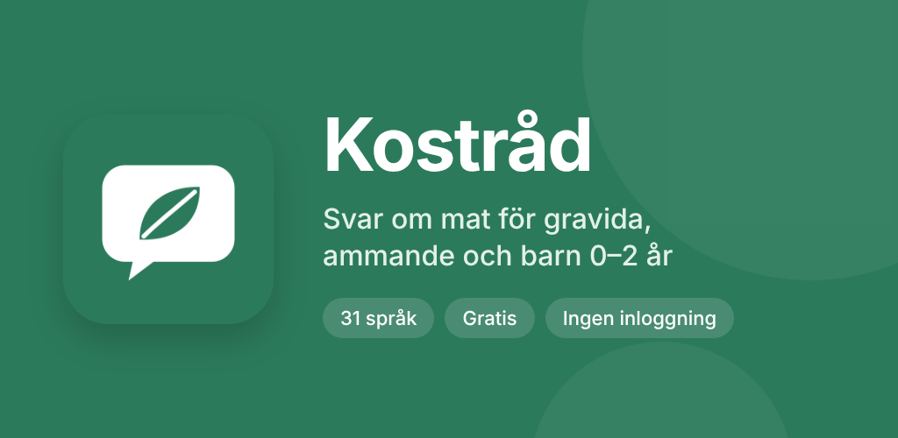
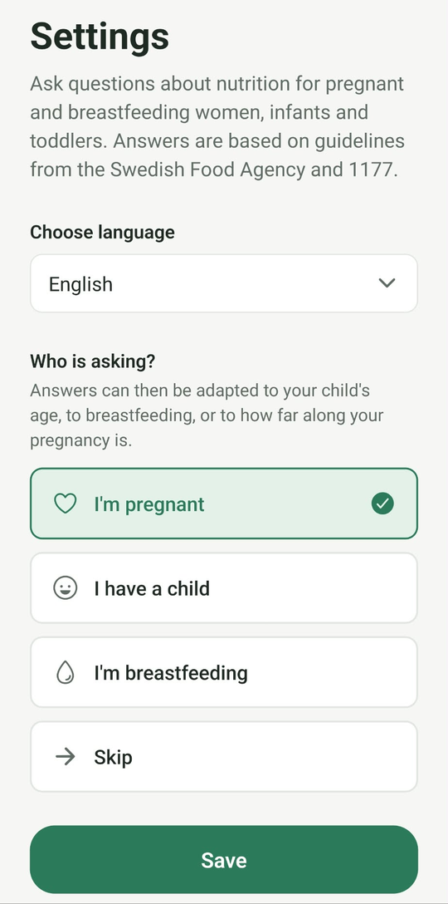
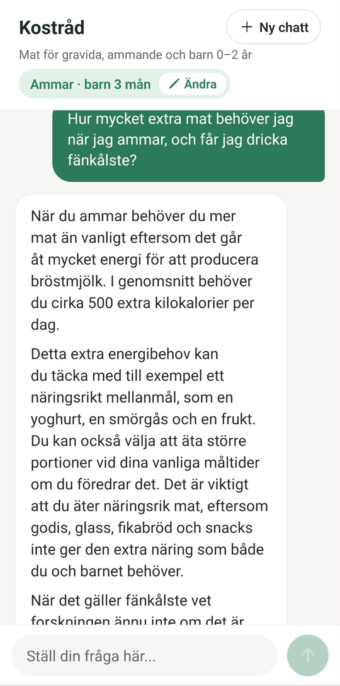
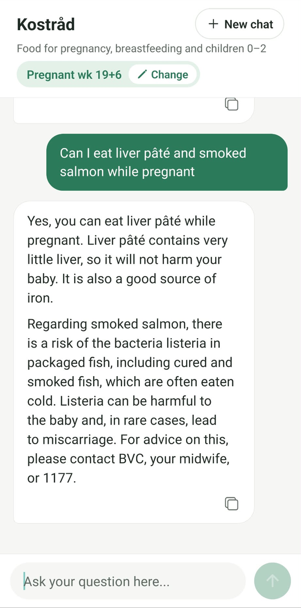
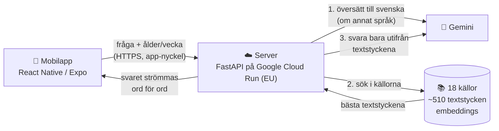
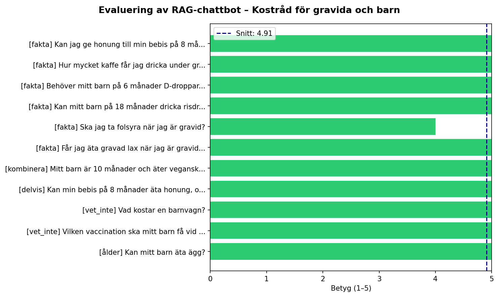

# Kostråd – AI-chattbot med kostråd för gravida, ammande och småbarn



**Kostråd** är en mobilapp där gravida, ammande och föräldrar till barn 0–2 år kan ställa frågor om mat
med egna ord – på svenska eller något av 30 andra språk – och få svar som **enbart bygger på
Livsmedelsverkets och 1177:s kostråd**. Finns svaret inte i källorna säger appen det, i stället för att gissa.

Ett eget projekt, byggt från idé till fungerande app i produktion: mobilapp, server i molnet,
AI-sökning (RAG), integritet/GDPR, tester, utvärdering och automatisk bevakning av källorna.

*English summary at the bottom.*

---

## Skärmdumpar

| Inställningar – språk och profil | Svar på svenska (ammar) | Svar på engelska (gravid) |
|---|---|---|
|  |  |  |

---

## Vad appen gör

- **Svarar på frågor om mat** under graviditet, amning och barnets första två år.
- **Källbundna svar:** AI:n får bara använda text från 18 källor från Livsmedelsverket och 1177. Om ingen källa
  matchar frågan tillräckligt bra svarar appen att den inte vet och hänvisar till BVC, barnmorskan eller 1177.
- **Anpassar svaren** efter graviditetsvecka, barnets ålder eller att man ammar – utan att skicka några datum.
- **31 språk**, inklusive höger-till-vänster-språk som arabiska och persiska. Hela gränssnittet och
  integritetspolicyn är översatta.
- **Frågor med flera delar** ("får jag dricka vin och kaffe?") besvaras del för del.
- **Kopiera, dela och rapportera** svar direkt i appen.

---

## Så fungerar det



1. **Förberedelse:** PDF:erna delas upp i textstycken (hela meningar, max ~1000 tecken) som görs om till
   embeddings med Gemini och sparas. Ett fingeravtryck av filerna gör att nya embeddings bara skapas när en källa ändras.
2. **Sökning:** frågan (och en svensk översättning, om den är på ett annat språk) jämförs med alla textstycken
   (cosine similarity). Frågor med flera delar delas upp så att varje del garanterat får egna träffar.
3. **Gräns för "vet inte":** ligger bästa träffen under `MIN_LIKHET` får AI:n ingen källtext alls och kan inte gissa.
4. **Svar:** Gemini svarar bara utifrån de hämtade textstyckena, på användarens språk, och svaret strömmas till appen.

---

## Teknik

| Del | Teknik |
|---|---|
| Mobilapp | React Native, Expo (SDK 58), EAS Build och EAS Update (uppdateringar utan nytt bygge) |
| Server | Python 3.12, FastAPI, Uvicorn, Docker, Google Cloud Run (europe-north1) |
| AI | Gemini 2.5 Flash (svar och översättning), Gemini Embedding (sökning) |
| Sökning (RAG) | Egen implementation med NumPy – ingen vektordatabas behövs för ~500 textstycken |
| Kvalitet | LLM-as-a-judge-utvärdering, enhetstester (`node --test`), låsta paketversioner, Dependabot |

---

## Lösningar jag är extra nöjd med

**Tillförlitlighet**
- Källbundna svar med en kalibrerad gräns för "vet inte" (se utvärderingen nedan).
- Regel i prompten om att källorna alltid går före tidigare svar i chatten, så ett tidigare "vet inte" inte låser fast samtalet.
- Avbrutna svar visas som fel i stället för som ett halvt råd.

**Flerspråkighet**
- Källorna är på svenska. Frågor på andra språk översätts till svenska innan sökningen, och båda versionerna söks –
  annars hamnar likheten för t.ex. spanska frågor ibland under gränsen fast svaret finns.

**Integritet (GDPR)**
- Dataminimering: födelsedatum/beräknat förlossningsdatum stannar i telefonen – servern får bara ålder eller vecka.
- Servern sparar inga frågor. Uttryckligt samtycke, integritetspolicy på 31 språk, server i EU.

**Säkerhet och drift**
- Servern är låst med en app-nyckel och har längdgränser på frågor och historik (skyddar mot dyra anrop).
- Larm i loggen när AI-krediterna tar slut, rapportera-funktion för felaktiga svar.
- En schemalagd AI-agent bevakar varje vecka om Livsmedelsverket uppdaterat någon källa, och uppdaterar
  och publicerar i så fall automatiskt efter validering.

---

## Utvärdering

[`evaluering.ipynb`](evaluering.ipynb) kör testfrågor genom exakt samma kod som appen och låter Gemini betygsätta
svaren (LLM-as-a-judge). Frågorna testar fakta, att kombinera flera källor, delvis besvarbara frågor, frågor utanför
ämnet ("vet inte") och att appen frågar efter barnets ålder när den saknas.

**Resultat: 4,91 av 5** på 11 frågor.



---

## Projektstruktur

```
├── rag.py                 # All RAG-logik: läsa PDF:er, chunkning, embeddings, sökning, prompter
├── api.py                 # FastAPI-server: strömmade svar, app-nyckel, rapporter, larm
├── Dockerfile             # Hur servern byggs för Google Cloud Run
├── requirements-server.txt
├── testa_sokning.py       # Felsökning: visar sökträffar och svar för en fråga
├── evaluering.ipynb       # Utvärdering med LLM-as-a-judge
├── kallor/                # Källornas PDF:er (ingår inte, se kallor/README.md)
└── app/                   # Mobilappen (Expo / React Native)
    ├── App.js
    └── src/
        ├── api.js                 # Pratar med servern (strömmade svar)
        ├── profil.js              # Ålder/graviditetsvecka från datum (+ profil.test.js)
        ├── texter.js, ui_texter.json, oversattningar.js   # 31 språk
        ├── integritetspolicy.*    # Policyn på 31 språk
        └── komponenter/           # Startsida, Chatt, Svarstext, Datumväljare
```

---

## Köra själv

**Server**
```bash
pip install -r requirements-server.txt   # installera paketen
cp .env.example .env                      # fyll i din Gemini-nyckel
# lägg källornas PDF:er i kallor/ (se kallor/README.md)
uvicorn api:app --port 8000               # skapar embeddings första gången och startar servern
```

**App**
```bash
cd app
npm install                               # installera paketen
cp .env.example .env                      # serverns adress och app-nyckel
npx expo start                            # öppna appen i Expo Go eller en emulator
```

---

## Om projektet

Byggt av **Christian Bergman** under utbildningen *BI-analytiker med AI-kompetens* (YH-Akademin, Göteborg), 2026.
Utvecklat iterativt med en AI-kodassistent som stöd; kravställning, avvägningar, testning, publicering och drift har jag gjort själv.

> Kostråd är ett portfolioprojekt. Appen ersätter inte medicinsk rådgivning och är inte en officiell tjänst
> från Livsmedelsverket eller 1177.

---

## English summary

**Kostråd** is a mobile app (React Native/Expo) where pregnant and breastfeeding parents and parents of children
aged 0–2 can ask food questions in 31 languages. Answers are generated by Gemini but **grounded only in 18 official
Swedish sources** (the Swedish Food Agency and 1177) through a custom RAG pipeline (FastAPI on Google Cloud Run,
NumPy cosine search). If no source matches well enough, the app says it doesn't know instead of guessing.

Highlights: query translation to Swedish before retrieval, per-sub-question retrieval for multi-part questions,
streamed answers, GDPR-minded design (dates never leave the phone, no stored questions, EU hosting),
app-key protection and input limits, in-app reporting, LLM-as-a-judge evaluation (4.91/5), unit tests,
pinned dependencies, and a scheduled AI agent that monitors the sources weekly and redeploys after validation.

*Portfolio project – not medical advice and not an official service of the Swedish Food Agency or 1177.*
